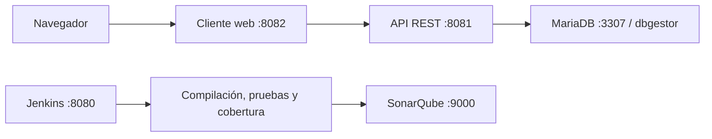
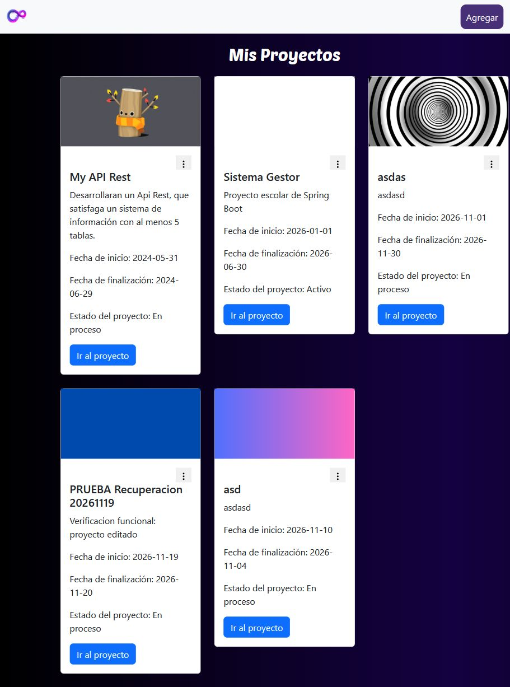
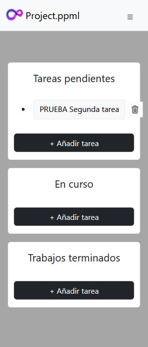
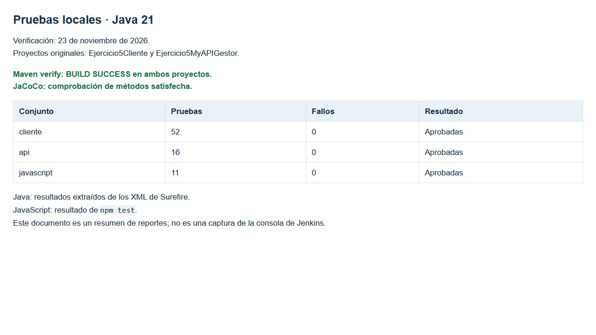
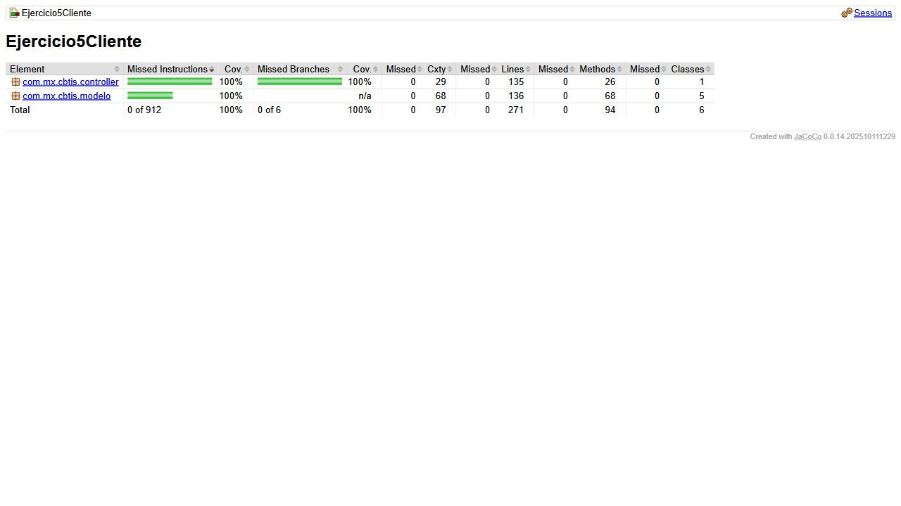
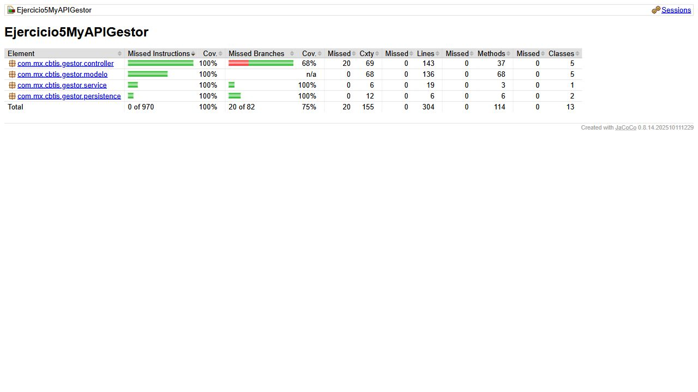
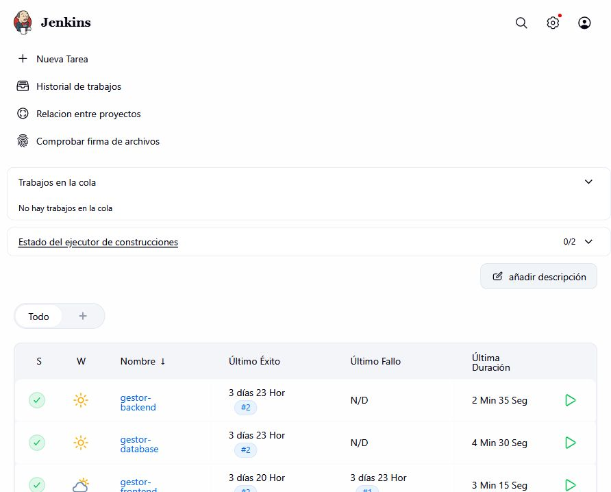
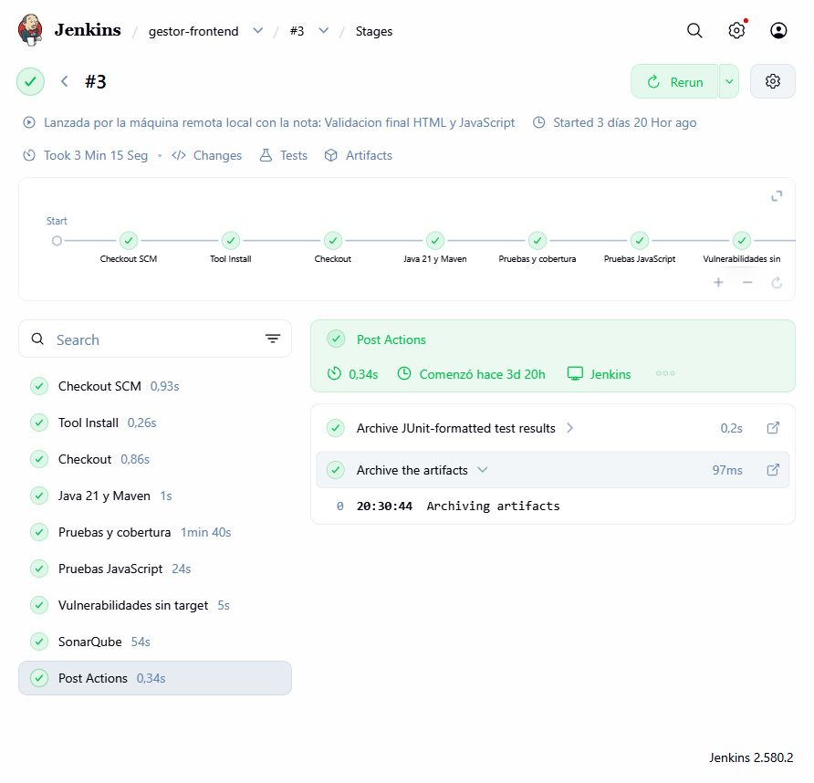
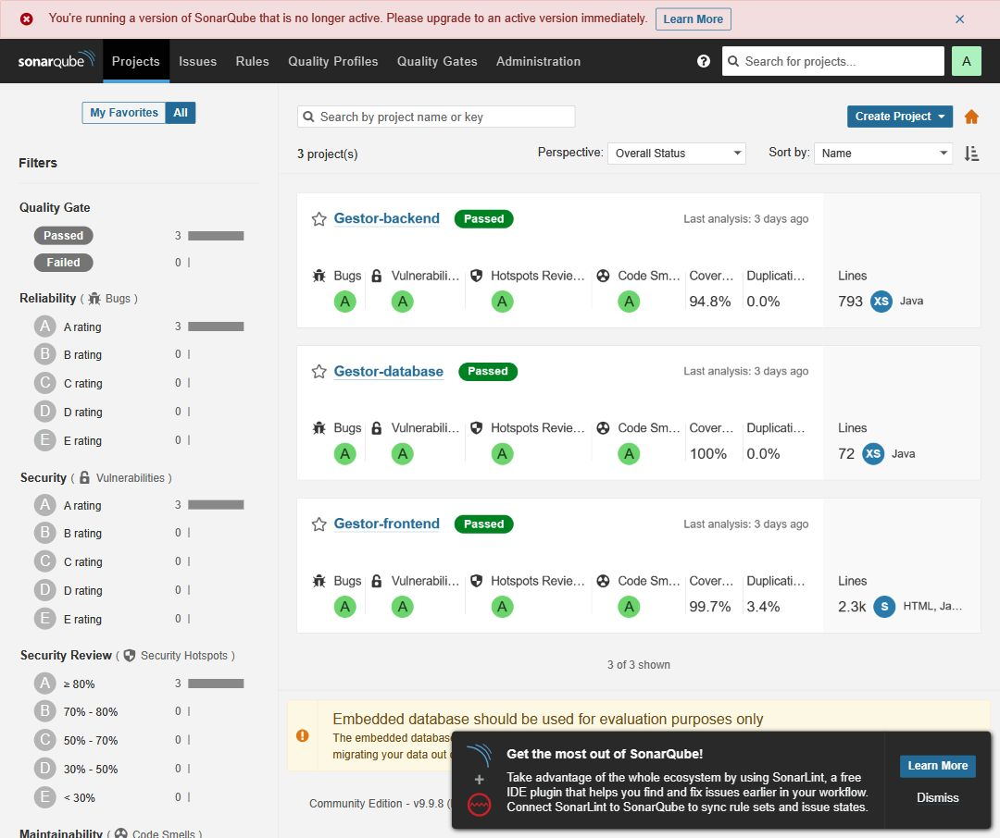
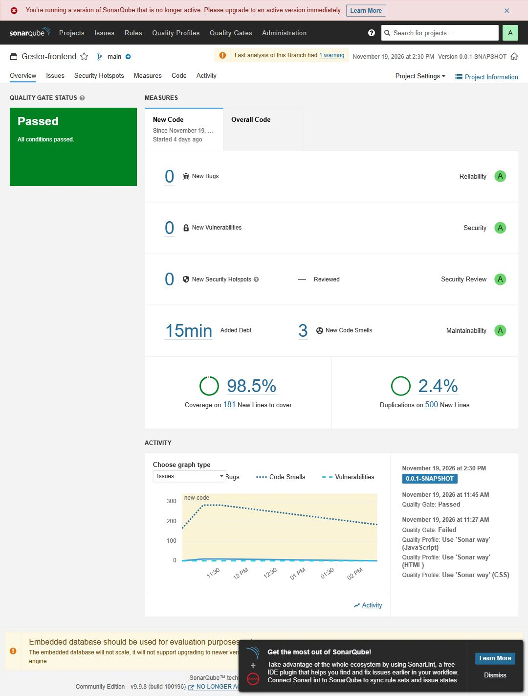

# Gestor de proyectos — actualización a Java 21

Aplicación académica para administrar usuarios, proyectos, tareas, comentarios y asignaciones. Consta de dos aplicaciones Spring Boot: un cliente web con Thymeleaf y una API que guarda la información en MariaDB.

Esta documentación corresponde a los **dos proyectos originales**, `Ejercicio5Cliente` y `Ejercicio5MyAPIGestor`. Las pruebas locales se repitieron el **23 de noviembre de 2026**. Los resultados de Jenkins y SonarQube corresponden a ejecuciones del **19 de noviembre de 2026**, cuyos paneles se capturaron nuevamente el día 23.

## 1. Arquitectura y servicios



| Componente | Dirección local | Función |
|---|---|---|
| Cliente | http://localhost:8082 | Pantallas y comunicación con la API |
| API | http://localhost:8081 | Operaciones y persistencia de datos |
| MariaDB | localhost:3307, base `dbgestor` | Datos de la aplicación |
| Jenkins | http://localhost:8080 | Automatización de la integración continua |
| SonarQube | http://localhost:9000 | Análisis estático y puerta de calidad |

MariaDB, Jenkins y SonarQube se ejecutan en Docker. El cliente y la API se ejecutan desde IntelliJ IDEA o Maven en el equipo. El cliente utiliza el puerto 8082 para evitar el conflicto con Jenkins.

## 2. Versiones anteriores y actualización

| Elemento | Cliente anterior | API anterior | Estado actualizado |
|---|---|---|---|
| Java | 17 | 11 | 21 en ambos proyectos |
| Spring Boot | 3.2.5 | 2.7.17 | 3.5.16 en ambos proyectos |
| Maven Wrapper | Consultar POM y configuración originales | Consultar configuración original | 3.9.11 |
| Compilación | Configuración anterior del proyecto | Configuración anterior del proyecto | `maven-compiler-plugin` 3.14.1, `release=21` |
| Pruebas unitarias | Configuración anterior | Configuración anterior | `maven-surefire-plugin` 3.5.5 |
| Cobertura | Configuración anterior | Configuración anterior | `jacoco-maven-plugin` 0.8.14 |
| Análisis Sonar | Configuración anterior | Configuración anterior | `sonar-maven-plugin` 5.5.0.6356 |

En la API también se utiliza `maven-failsafe-plugin` 3.5.5 para la prueba de integración con la base de datos. CycloneDX 2.9.1 genera el inventario de dependencias resueltas. Se aplicaron versiones de Jackson 2.21.7, Tomcat 10.1.59 y Log4j 2.25.5; el controlador MariaDB de la API quedó en 3.5.11.

### Evidencia de los cuatro POM

- [POM original del cliente](docs/pom/antes/pom-cliente.xml).
- [POM original de la API](docs/pom/antes/pom-api.xml).
- [POM actualizado del cliente](docs/pom/despues/pom-cliente.xml).
- [POM actualizado de la API](docs/pom/despues/pom-api.xml).

Las copias anteriores conservan el estado previo a la actualización; las copias posteriores corresponden a los POM de los proyectos al documentar esta entrega.

## 3. Qué cambió y por qué

### API

- Migración de las importaciones de persistencia `javax` a `jakarta`, requerida al pasar de Spring Boot 2 a 3.
- Identificadores con estrategia `IDENTITY`, compatibles con las columnas `AUTO_INCREMENT` existentes.
- Conversión de fechas para conservar el formato utilizado por el cliente y la base de datos.
- Validación del esquema con `ddl-auto=validate`; el arranque comprueba su compatibilidad sin recrear las tablas.
- Configuración de conexión mediante variables de entorno o un archivo local privado.
- BCrypt para contraseñas nuevas o modificadas y exclusión de la contraseña en las respuestas JSON. Se conserva compatibilidad con registros antiguos en texto plano; su migración completa sigue siendo una tarea pendiente.
- Eliminación transaccional de proyectos y tareas junto con sus comentarios y asignaciones relacionadas.

### Cliente

- Comunicación con la API configurable mediante `API_URL` y uso de `RestTemplateBuilder` para facilitar las pruebas.
- Correcciones de rutas de tareas, respuestas de comentarios y manejo de fechas.
- Validación de formularios, correcciones de envío duplicado y retiro de tareas ficticias.
- Escape de contenido dinámico en HTML y atributos; restricción de fondos a recursos locales permitidos.
- Correcciones de JavaScript, HTML y CSS detectadas por el análisis de calidad.

### Compilación y verificación

Ambos proyectos compilan para Java 21. Surefire ejecuta las pruebas Java, JaCoCo genera cobertura y verifica el umbral de métodos, y Sonar recibe los reportes de cobertura. El cliente añade pruebas JavaScript y un reporte LCOV. Jenkins utiliza JDK 21 y Maven 3.9.11.

## 4. Cómo ejecutar los proyectos originales

### Preparación

1. Iniciar Docker Desktop y los contenedores existentes `mariadb-gestor`, `jenkins` y `sonarqube`. Para usar únicamente la aplicación basta con MariaDB y los dos proyectos Java.
2. Comprobar que existe `dbgestor` en MariaDB y que su puerto publicado es 3307.
3. Seleccionar **JDK 21** como SDK del proyecto y como JDK de Maven en las dos ventanas de IntelliJ. Recargar cada proyecto Maven si IntelliJ lo solicita.
4. Abrir cada carpeta original como proyecto Maven independiente.

### API: iniciar primero

Abrir `Ejercicio5MyAPIGestor` y ejecutar `Ejercicio5MyApiGestorApplication`, o la configuración `Backend-local` incluida en `.run`. El directorio de trabajo debe ser la raíz de la API.

La conexión admite estas variables:

```text
DB_URL=jdbc:mariadb://localhost:3307/dbgestor
DB_USER=usuario_de_la_base
DB_PASSWORD=contraseña_local
PORT=8081
```

También se carga opcionalmente `application-local.properties` desde la raíz de la API. Este archivo privado se excluye de Git y permite guardar la conexión local sin incluir contraseñas en el código. No debe colocarse dentro de `src/main/resources` ni adjuntarse a la entrega. La importación opcional corrige el arranque que antes enviaba una contraseña vacía a MariaDB.

Desde PowerShell, dentro de la carpeta de la API:

```powershell
.\mvnw.cmd spring-boot:run
```

Esperar el mensaje `Started Ejercicio5MyApiGestorApplication` antes de iniciar el cliente.

### Cliente: iniciar después

Abrir `Ejercicio5Cliente` y ejecutar `Ejercicio5ClienteApplication`, o la configuración `Frontend-local`. La API debe estar disponible en `http://localhost:8081`.

```powershell
.\mvnw.cmd spring-boot:run
```

Entrar a http://localhost:8082. Usar una cuenta de prueba propia; las credenciales personales no forman parte de este README.

Si aparece `Project JDK is not defined`, seleccionar el JDK 21 instalado y recargar Maven. Si MariaDB indica `using password: NO`, revisar el directorio de trabajo y la configuración privada de conexión. No iniciar una segunda instancia sobre un puerto que ya esté ocupado.

## 5. Evidencia de funcionamiento de la aplicación

Capturas reales del 23 de noviembre de 2026. Los proyectos visibles pertenecen a la base local utilizada durante la revisión.

### Portada


### Panel de proyectos

<details>
<summary>Ver captura completa del panel de proyectos</summary>



</details>

### Tablero de un proyecto



## 6. Pruebas y cobertura

### Verificación local del 23 de noviembre de 2026

| Verificación | Resultado |
|---|---|
| Cliente Java: Maven `verify` | 52 pruebas, sin fallos |
| API Java: Maven `verify` | 16 pruebas, sin fallos |
| JavaScript: `npm test` | 11 pruebas, sin fallos |
| Recorrido funcional HTTP | 87 comprobaciones, todas correctas |

El recorrido funcional verifica páginas, registro e inicio de sesión válido e inválido, operaciones de proyectos, tareas, comentarios y asignaciones, y comprueba la eliminación de los datos creados para la prueba. Utiliza un prefijo `QA_` y elimina sus propios registros. No equivale a una prueba de carga ni a una auditoría completa de seguridad.

| Cobertura local | Cliente Java | API Java | JavaScript |
|---|---|---|---|
| Métodos / funciones | 94/94, 100 % | 114/114, 100 % | 100 % |
| Líneas | 271/271, 100 % | 304/304, 100 % | 100 % |
| Ramas | 6/6, 100 % | 62/82, 75.6 % | 96.9 % |

La regla JaCoCo exige 100 % de métodos cubiertos y excluye la clase de arranque `*Application`. **100 % de métodos no significa 100 % de ramas**: la API conserva ramas sin recorrer. La tabla HTML de JaCoCo redondea su porcentaje de ramas a 75 %.



La captura anterior muestra el resumen de las pruebas Java y JavaScript generado a partir de sus reportes; el recorrido HTTP se conserva por separado en el resultado enlazado a continuación.

- [Resumen de resultados locales y contadores](docs/resultados/verificacion-local-2026-11-23.json).
- [Pruebas Java del cliente](docs/resultados/junit-cliente-2026-11-23.xml) y [de la API](docs/resultados/junit-api-2026-11-23.xml): resúmenes de los reportes Surefire, sin propiedades del entorno.
- [Salida de JavaScript](docs/resultados/javascript-2026-11-23.txt).
- [Resultado detallado de las 87 comprobaciones HTTP](docs/resultado-funcional.json).
- [Salida del recorrido HTTP](docs/resultados/funcionales-2026-11-23.txt).
- [Reporte navegable JaCoCo del cliente](docs/cobertura/cliente/index.html) y [de la API](docs/cobertura/api/index.html). Descargar o abrir localmente los HTML para navegar sus detalles.





### Cómo repetir las pruebas

Desde cada carpeta Java:

```powershell
.\mvnw.cmd verify
```

Para reconstruir desde cero, detener primero la aplicación correspondiente y ejecutar ` .\mvnw.cmd clean verify`. Así se evita borrar `target` mientras IntelliJ está utilizando sus clases.

Desde la carpeta del cliente, con Node.js y npm disponibles:

```powershell
npm ci
npm test
```

Para repetir el recorrido funcional, mantener la aplicación y la API encendidas y ejecutar desde la raíz del repositorio:

```powershell
python docs/verificar-funcional.py
```

El script está preparado para los puertos locales indicados y contempla un proyecto de ejemplo con identificador 224 en una comprobación de página; revisar esa referencia si se usa otra base. Al ejecutarlo se reemplaza su archivo `resultado-funcional.json` con los resultados de la nueva ejecución.

La prueba `MariaDbIT` se ejecutó en Jenkins el 19 de noviembre con el perfil `database-ci`. Usa una base independiente `gestor_ci` en el puerto 13307 y credenciales de Jenkins. Recrea sus tablas de prueba; **no debe apuntarse a `dbgestor`**. No se volvió a ejecutar este perfil al documentar las verificaciones locales del día 23.

## 7. Jenkins: para qué sirve aquí

Jenkins automatiza la revisión del código obtenido desde Git: comprueba Java y Maven, compila, ejecuta pruebas, produce cobertura e inventarios de dependencias, ejecuta análisis y envía los resultados a SonarQube. De esta manera, una ejecución deja evidencia repetible de lo que se revisó.

La instalación revisada utiliza Jenkins 2.580.2 con Java Temurin 21.0.13. Sus herramientas están configuradas como `JDK21` y `Maven3.9.11`; el análisis JavaScript utiliza Node 22.23.5 y el análisis de dependencias utiliza Trivy 0.67.2.

| Job | Ejecución documentada | Resultado | Definición |
|---|---|---|---|
| gestor-frontend | #3, 19/11/2026 | SUCCESS | [Jenkinsfile cliente](Ejercicio5Cliente/Jenkinsfile) |
| gestor-backend | #2, 19/11/2026 | SUCCESS | [Jenkinsfile API](Ejercicio5MyAPIGestor/Jenkinsfile) |
| gestor-database | #2, 19/11/2026 | SUCCESS | [Jenkinsfile persistencia](Ejercicio5MyAPIGestor/database/Jenkinsfile) |





Las capturas son del 23 de noviembre; las ejecuciones mostradas son del 19. [Registro de ejecuciones, resultados y commits analizados](docs/resultados/jenkins-ejecuciones-2026-11-19.json). Estas ejecuciones no demuestran que los cambios locales posteriores ya estén publicados o analizados por Jenkins.

Para reproducir una ejecución: abrir el job, revisar que su repositorio y rama correspondan al código que se desea analizar, pulsar **Build Now**, y comprobar la consola, las pruebas y los artefactos. El token de Sonar y las credenciales de la base de pruebas se guardan en Jenkins, fuera del código.

## 8. SonarQube: reglas y criterios de calidad

SonarQube analiza el código y combina sus hallazgos con los reportes de cobertura producidos por las pruebas. Las reglas activas del perfil detectan problemas de fiabilidad, seguridad y mantenibilidad. La **Quality Gate** decide si se aprueban las condiciones evaluadas; no sustituye las pruebas funcionales.

La instalación local es SonarQube 9.9.8.100196. Se utilizan perfiles **Sonar way** para los lenguajes analizados: Java en API y persistencia; Java, JavaScript, HTML y CSS en el cliente.

| Proyecto | Quality Gate | Cobertura global mostrada |
|---|---|---|
| Gestor-frontend | Passed | 99.7 % |
| Gestor-backend | Passed | 94.8 % |
| Gestor-database | Passed | 100 % |



### Condiciones observadas

En el cliente, la puerta evalúa el código nuevo con calificaciones A de fiabilidad, seguridad y mantenibilidad, cobertura mínima del 80 %, duplicación máxima del 3 % y revisión de los hotspots cuando existan. El resultado documentado muestra **98.5 % de cobertura de código nuevo y 2.4 % de duplicación**. La definición de código nuevo utiliza `PREVIOUS_VERSION`.

En los resultados archivados de API y persistencia se evaluaron las tres calificaciones A. No se debe atribuir a esos proyectos una comprobación de cobertura del 80 % dentro de la puerta si esa condición no figura en su resultado.



La cobertura global de Sonar puede diferir de JaCoCo local porque considera el alcance y los lenguajes del análisis y, en estas capturas, corresponde al análisis anterior del 19 de noviembre. La cobertura de código nuevo es otra medida distinta.

Se corrigieron 9 problemas de HTML/CSS y 85 avisos críticos relacionados con el uso de `var`. El análisis documentado quedó con cero bugs y conserva avisos de mantenibilidad: 183 en cliente, 111 en API y 3 en persistencia. Una puerta aprobada no implica ausencia de todos los avisos.

El hotspot asociado a `Math.random` se revisó como seguro porque selecciona un color de avatar y no genera tokens, claves ni identificadores de seguridad. Su revisión no significa que `Math.random` sea adecuado para usos criptográficos.

## 9. Dependencias y límites de seguridad

En la revisión del 19 de noviembre se generaron inventarios CycloneDX de las dependencias resueltas y se analizaron con Trivy. El inventario completo evita depender exclusivamente de la lectura del POM.

| Inventario | Hallazgos iniciales | Críticos residuales tras los cambios |
|---|---|---|
| Cliente | 92: 15 críticos, 32 altos, 31 medios, 14 bajos | 2 |
| API | 118: 10 críticos, 43 altos, 49 medios, 16 bajos | 2 |

Los dos críticos residuales corresponden a `CVE-2026-47884` y `CVE-2026-47890`. Se documentaron como no aplicables a la configuración revisada al no utilizar las funcionalidades afectadas de XSLT y fragmentos de vistas SSE; las pruebas de configuración apoyan esa revisión. **El escáner mantiene su clasificación crítica**: no se presentan como vulnerabilidades corregidas en la biblioteca. Esta tabla es histórica y no constituye un escaneo nuevo del día 23.

La aplicación sigue siendo una práctica académica: requiere revisar la autorización de operaciones, migrar las contraseñas antiguas y realizar una evaluación adicional antes de un uso público. La instalación local de SonarQube también es de evaluación, con una versión antigua y base integrada. Los resultados no certifican la seguridad de todas las imágenes Docker ni un despliegue de producción.

## 10. Evidencias que integran la entrega

- Este README: descripción, arquitectura, versiones anteriores y nuevas, explicación de cambios, ejecución, pruebas y criterios de calidad.
- Los cuatro POM conservados en `docs/pom`.
- Capturas reales de la aplicación, Jenkins, SonarQube y JaCoCo en `docs/evidencias`.
- Resultados de pruebas y referencia de las ejecuciones de Jenkins en `docs/resultados`.
- Reportes navegables de cobertura en `docs/cobertura`.
- Código de los dos proyectos originales y sus Jenkinsfile.
- Video: 

